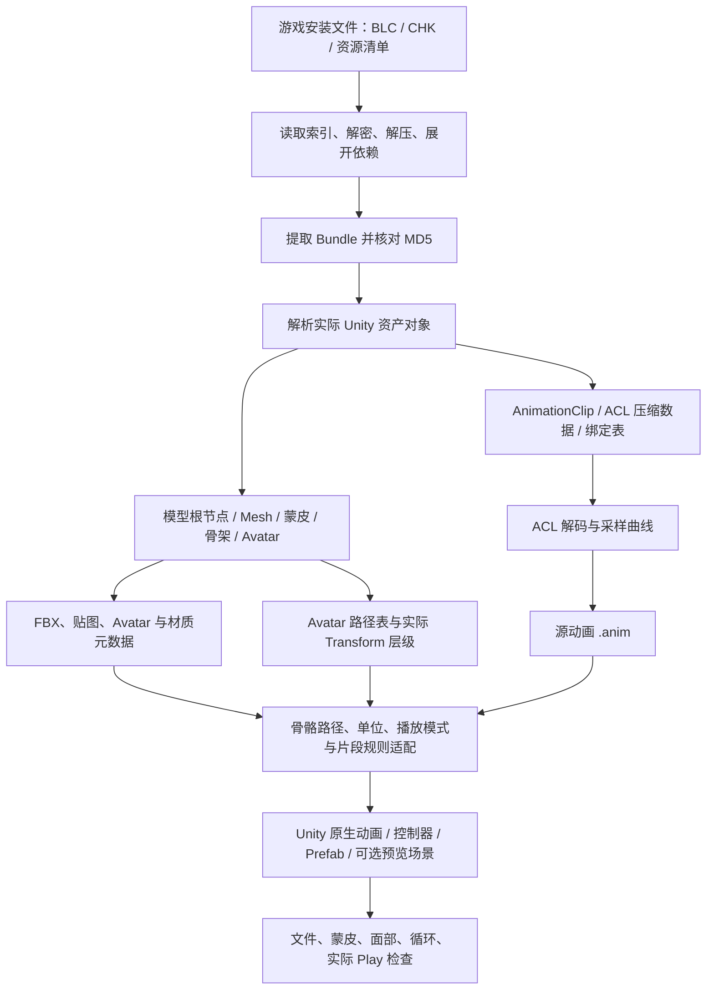

# 终末地模型、骨架与动画：提取修复技术栈及完整流程

2026-10-26 补充：0.11.1 已在独立工程修复通用流程丢弃专属行走肌肉通道的问题，新增唯一源人形映射、逐动作 Generic／Humanoid Avatar 切换及直接打开播放。三条行走与两条待机混合 Play 已实测；详见[播放故障复现与修复记录](播放故障复现与修复记录.md)。下方为此前技术栈快照。

整理日期：2026-10-25。依据本机源码、补丁、导出文件和既有验证报告整理。

当前通用工具源码基线：`b512a15`（0.9.0）；历史陈千语专用流程和验证另按对应记录说明。

这份文档回答三个问题：**动画怎样从游戏文件中解出来；模型、骨架和权重怎样一起保留；为什么还需要在 Unity 中修正，以及具体如何修正。**

## 1. 先说明当前实际完成范围

已经打通的流程是：读取游戏资源 → 解密／解压 → 找到实际模型、Avatar 和 AnimationClip → 解码压缩动画 → 导出带蒙皮的 FBX 与源 `.anim` → 按实际骨架适配 → 在 Unity 生成可播放资产并检查效果。

其中有三组不同的证据：

| 阶段 | 已有结果 | 结论边界 |
| --- | --- | --- |
| 陈千语专用流程、六条界面待机 | 实际重新提取、骨架／权重检查、Unity 适配、采样、循环及 Play 检查 | 当前片段和本机检查范围成立，未与原游戏逐帧对照 |
| 通用工作台 0.6.1 原始导出 | 实际导出模型加八条动画，以及不带模型的两条动画 | 证明原始对象导出有效，未在该轮验证 Unity 播放 |
| 通用工作台 0.7.0～0.9.0 适配、自动导入、预览场景 | 已实现、编译和打包 | 完整新流程和预览交互尚未实测，不能借用旧待机结果认定通过 |

“完整提取”需要限定到具体资源和片段。游戏全部角色、全部 Root Motion、叠加动画、实时布料、IK、修正骨骼求解和着色器仍有未完成部分。

## 2. 技术栈总表

| 层次 | 使用的技术 | 在项目中的作用 |
| --- | --- | --- |
| 桌面界面 | **C#、.NET 10、Windows Forms** | 角色／资源搜索、任务计划、对象选择、适配设置、进度、取消和日志 |
| 流水线 | **Python 3.11.13**（本机 Blender 自带） | 文件编排、索引解析、依赖展开、调用导出器、路径适配、来源与结果记录 |
| 容器与索引 | **ZMD_unpack 的 VFS 读取思路／代码、BLC／CHK 解析、Manifest 解析** | 从安装文件定位资源范围、依赖与 Bundle |
| 解密和清单解压 | **ChaCha20、Brotli，C# 辅助程序** | 按已支持的游戏布局解密索引／资源，解压资源清单 |
| Unity 资产解析 | **AnimeStudio / EndfieldStudio 相关库** | 读取 GameObject、Transform、Mesh、SkinnedMeshRenderer、Avatar、AnimationClip 等对象 |
| 动画压缩解码 | **Ruri.ACL + 本地 AnimeStudio 集成补丁** | 解码 ACL Transform／Float 数据，重建可导出的采样曲线 |
| 模型导出 | **AnimeStudio ModelConverter、ModelExporter、FBXWrapper 及配套 x64 原生库** | 输出 FBX，保留层级、蒙皮和 BlendShape；另导出贴图与元数据 |
| 其他底层组件 | 解析库配套的压缩／纹理解码依赖，如 **ZstdSharp、Texture2DDecoder** | 支撑底层资产读取；按各自依赖目录隔离部署 |
| Unity 适配 | **Unity 6000.0.84f1、UnityEditor C# API** | 原生重建曲线、配置模型导入器、创建 Avatar／控制器／Prefab／场景 |
| Unity 运行时 | **Animator、Generic／Humanoid、MonoBehaviour、IMGUI** | 播放与片段切换、暂停、重播、调速和查看；新通用预览交互尚未实测 |
| 几何与权重检查 | **Blender 5.0.1、bpy**；Unity **SkinnedMeshRenderer.BakeMesh** | 独立检查骨骼／顶点权重；采样播放后的实际变形网格 |
| 索引缓存 | **SQLite（Python sqlite3）** | 保存 CHK 扫描缓存，减少重复扫描 |
| 记录与完整性 | **JSON、MD5、SHA256、文件锁、独立运行 ID** | 追溯来源、验证文件、区分阶段和保护已有结果 |
| 开发与交付 | **Git、PowerShell 7、dotnet / MSBuild** | 版本管理、编译、依赖隔离及运行包生成 |

本机 Python 版本在本次整理时读取为 3.11.13。使用 Blender 自带 Python 运行普通脚本时，不需要启动 Blender 应用；只有调用 `bpy` 的模型检查阶段才需要 Blender 环境。用户后来要求暂不处理 Blender，后续工作遵循这一要求。

## 3. 整体链路

最后的检查需实际执行并记录。当前 0.9.0 新流程只完成实现与编译，未走到实际 Play 检查。

## 4. 第一层：怎样从安装文件找到资源

### 4.1 游戏文件与提取对象

本机游戏数据位于：

`F:/AAA_ZMD/Hypergryph Launcher/games/Arknights Endfield/Endfield_Data`

这一安装结构中的分组索引和数据块承担不同职责：

- **BLC**：描述资源位于哪个数据块、偏移、长度、加密标记、校验信息等。
- **CHK**：保存相应数据块内容。
- **资源 Manifest**：提供 Bundle 记录、引用关系及依赖信息。
- **GameAssembly SHA256**：在本工具中用作游戏程序版本指纹。

本机已有验证对应游戏版本 `20260821_c24495e5`。新版本需要重新识别和校验，不能沿用旧资源位置。

### 4.2 解密、解压与依赖

读取器按已支持的 VFS 布局使用 ChaCha20；加密资源的 nonce 由相应版本／种子等字段按源码规则组成。资源清单通过 Brotli 解压后再解析结构。

找到一个角色 Bundle 后，还要补齐它引用的模型、Avatar、贴图和动画相关依赖。工具使用 Manifest 依赖展开，缺失或不明确的依赖保留报告。

提取时按记录从 CHK 的指定区间读取，按需解密，并检查导出数据 MD5。较大的区间由 C# 辅助程序分块处理，避免把整个 CHK 一次读入内存。

核心入口：

- `scripts/endfield_vfs.py`、`scripts/endfield_manifest.py`：VFS 与清单读取。
- `scripts/index_formats.py`：格式识别及严格边界校验。
- `scripts/index_game_resources.py`：名称候选发现、SQLite 缓存。
- `scripts/extract_plan_bundles.py`：计划执行、依赖与恢复。
- `Crypto/Program.cs`、`Crypto/BundleExtractor.cs`：解密、Brotli 和流式提取辅助。

名称搜索得到的是候选。实际对象解析和引用关系决定后续选择；仅知道名字或一个索引号，还不足以确认模型与动作配套。

## 5. 第二层：模型、骨架和权重怎样一起提取

### 5.1 读取原始关联关系

解析器加载 Bundle 后，读取模型根 GameObject、Transform 层级、Mesh、SkinnedMeshRenderer、Animator 及 Avatar 引用。

其中需要配套保留：

| 数据 | 用途 |
| --- | --- |
| 顶点、三角形、法线、UV | 模型几何与显示 |
| Transform 父子关系与静止变换 | 骨架层级和静止姿势 |
| SkinnedMeshRenderer 的骨骼引用 | 把蒙皮中的索引关联到实际骨骼 |
| 每顶点骨骼索引及权重 | 指定顶点受哪些骨骼影响 |
| 绑定矩阵／绑定姿势 | 将静止网格与骨骼空间配套 |
| BlendShape | 模型自带的形状变化数据，导出选项保留 |
| Avatar 元数据 | 人形映射、路径表和相关骨架信息 |

本项目沿用游戏原始骨架与蒙皮关系，主要工作是正确解析、转换和导出，没有对模型进行重新自动绑骨或人工重刷权重。

### 5.2 FBX 和元数据导出

使用 `ModelConverter` 建立模型转换结果，再经 `ModelExporter.ExportFbx` 写出 FBX。当前导出选项包括：

- `exportAllNodes=true`：保留节点。
- `exportSkins=true`：导出蒙皮。
- `exportBlendShape=true`：保留可导出的形状变化。
- `exportAnimations=false`：模型 FBX 与独立动画导出分开管理。

同时保存贴图、`materials.json`、`material_properties.json`、`avatar_retarget.json`。Avatar 元数据包含 `m_TOS`、人形骨骼映射、骨架节点及相关变换等。

新版工作台用 **来源 Bundle + 序列化资产文件 + 64 位 PathID** 精确定位对象，并依据实际 Animator 引用自动选择 Avatar。相同名字的对象可以属于不同来源，因此不能只按名字取第一个。

### 5.3 为什么单位或绑定关系错误会拉坏网格

蒙皮变形依赖权重、当前骨骼变换和绑定矩阵共同作用。概念上可理解为每个顶点由若干骨骼变换按权重加权得到。

骨骼数组顺序、绑定姿势、单位或实际层级错配，都可能产生拉伸、扭转或关节偏移。因此排查同时覆盖模型数据、导入设置与动画轨道。

本机一个独立 FBX 导入记录为 **10 个网格、56,490 个顶点、324 根骨骼**。早期场景姿势检查统计的 459 个内部 Transform 节点采用另一种口径，包含的对象集合不同。

### 5.4 独立权重检查

历史上使用 Blender `bpy` 导入 FBX，逐顶点检查：

- 未赋权顶点。
- 非法顶点组引用。
- 非有限权重。
- 权重和偏离 1 超过 1% 的顶点。
- 有权重但找不到对应骨骼的分组。

陈千语已有检查中，上述异常计数均为 0。数值正常仍需结合动态形变检查，不能据此认定所有姿势都正确。

旧专用检查脚本还固定要求 10 个网格和 56,490 个顶点，这是陈千语基线，不能直接作为其他角色的合格条件。

## 6. 第三层：ACL 动画怎样真正解出来

### 6.1 早期为什么“有 anim 文件却没有动作”

部分早期 `.anim` 虽然生成了文件，但曲线和关键帧为零。原因在于对应压缩动画数据没有经过正确解码，仅生成外层文件无法还原运动。

后续采用 ZMD_unpack 对应的解析思路与锁定源码，将 Ruri.ACL 接入 AnimeStudio 动画转换器，并保留本地集成补丁。

### 6.2 实际解码步骤

本地补丁 `DecodeEndfieldAclBuffer` 的主要过程：

1. 判断终末地片段及 ACL 缓冲是否存在。
2. 用 `AclDecompressor` 读取 Transform 缓冲，用 `AclFloatDecompressor` 读取 Float 缓冲。
3. 检查解码器有效性及 Float 轨道数量与绑定表是否一致。
4. 按片段采样率与解码时长计算采样帧数。
5. 在各采样时刻取得位置、四元数旋转、缩放及 Float 值。
6. 按 `genericBindings` 的顺序和维度写入 DenseClip 样本。
7. 由后续转换器生成实际曲线并输出 Unity YAML `.anim`。

当前补丁对 Transform 的主要维度为：位置 3 个分量、旋转四元数 4 个分量、缩放 3 个分量。遇到不支持的属性或轨道布局不符会失败并报告。

这是按采样率重建曲线，导出的 `.anim` 与游戏压缩缓冲不是字节级同一份数据。当前补丁重点处理 Transform／Float 缓冲；**独立 RootMotionBuffer 的完整恢复不列入已证明能力**。

### 6.3 骨骼路径怎样恢复

动画绑定中可能只有路径哈希，导出器会出现 `path_数字` 形式的占位路径。

处理来源有两种：

- 从实际 GameObject／Transform 层级生成路径，使用解析器的 CRC 哈希对应关系。
- 使用目标 Avatar 的 `m_TOS`，把哈希对应到骨骼相对路径。

新版精确导出显式使用选定 Avatar 的路径表。随后还要与 Unity 实际导入的完整层级匹配：优先精确路径，其次仅接受唯一后缀匹配；歧义或未知路径保留报告。

未匹配轨道默认使适配停止，用户可以明确选择忽略并记录。源文件保留未知路径，避免为了消除警告而猜测骨骼。

### 6.4 怎样证明导出了实际数据

记录和检查曲线数、关键帧数、变化曲线数、时间范围、未解析路径、非有限数值及时间顺序。

0.6.1 独立文件检查的部分结果：

| 片段 | 标量曲线数 | 关键帧数 | 未解析路径数 |
| --- | ---: | ---: | ---: |
| 总览待机 `ui_overview_loop` | 705 | 85,305 | 0 |
| 放松待机 `ui_relax_loop` | 720 | 115,920 | 0 |
| 四条 `uiteam_idle_01～04` | 各 771 | 各 116,421 | 0 |
| 专属行走 `customized_state_walk_loop` | 786 | 99,036 | 0 |
| 共享行走 `female_walk` | 971 | 5,735 | 475 |

这些是原始导出统计，包含多个通道类别，不等于相同数量的骨骼。共享行走仍有 475 条未知路径，不能将它描述为所有轨道已完整解析。

## 7. 第四层：在 Unity 中具体修正什么

### 7.1 配套模型单位、Avatar 和层级

使用 `ModelImporter` 明确配置模型倍率、保留层级、关闭骨架优化，并核对蒙皮设置。当前模板设置最多每顶点 4 个骨骼影响、最小权重阈值 `0.00001`。

这是当前预览的导入配置。迁移到其他角色时还需核对源网格的影响骨骼数量和小权重，不能把该设置当作所有模型都无损的通用条件。

当前已收录且版本／模型标识匹配的陈千语链路使用模型导入倍率 100；新角色默认 1，由实际单位决定。动画位置倍率单独记录，改变位置值时同步处理切线。

早期专属行走示例依据源 `HumanDescription`、实际导入静止骨架，通过 `AvatarBuilder.BuildHumanAvatar` 建立 Humanoid Avatar，并检查有效性及 `humanScale`。记录中的比例约为 0.99173。

### 7.2 按片段选择 Generic 或 Humanoid

| 片段／入口 | 当前处理及依据 |
| --- | --- |
| 六条专属界面待机 | 使用 Generic 直接骨骼曲线；现有 Humanoid 根通道会导致身体被压低 |
| 共享行走预览 | 使用相应直接骨骼适配，并保留陈千语中性面部 |
| 已有专属行走示例 | 保留经独立检查的 Humanoid 方案；膝部指标优于直接套用 Generic 源动画 |
| 新通用适配页 | 当前实现 Generic 直接 Transform 曲线；不是自动选择最佳播放模式的系统 |

Generic 直接使用实际骨骼变换；Humanoid 还涉及人形映射与肌肉／根通道。一个文件同时包含两类信息时，需要结合片段和实际效果判断。

### 7.3 用 Unity 原生 API 重建动画

主要 API 为：

- `AnimationUtility.GetCurveBindings`、`GetEditorCurve`：读取实际绑定和曲线。
- `AnimationUtility.SetEditorCurves`：把适配后的曲线写入新 AnimationClip。
- `AnimationClip.EnsureQuaternionContinuity`：处理四元数连续性。
- `AnimationUtility.SetAnimationClipSettings`：保存循环等设置。
- `AnimatorController`、`PrefabUtility`、`EditorSceneManager`：创建播放资产及场景。

适配包括路径映射、位置单位、指定节点首帧位移归零、按规则排除轨道，以及清理不适合该播放模式的通道。新 Generic 模板只保留 Transform 曲线，跳过 Animator 肌肉／根通道和其他组件轨道。

根位移归零针对明确指定的节点；场景空路径位置轨道与骨架内部位移分开处理。

### 7.4 修复无效插值

检查关键帧时间、数值与切线。非有限关键帧值会拒绝处理；历史共享动画中发现的非有限切线，在生成片段中修整，并以常量侧切线方式记录处理。

原始解码文件单独保存，修正写入新片段，保留来源和审计信息。

### 7.5 共享面部与眼部材质

共享 `female_walk` 携带与陈千语不匹配的面部固定变换。历史对照中，96 个面部蒙皮骨骼有 78 个偏离中性姿势，最大位置差约 19.64 毫米。

专用修正根据面部网格实际使用的骨骼及祖先定位相关节点，在共享行走预览中排除对应 800 条标量曲线，保留中性面部。角色专属待机保留自身表情，不套用共享过滤规则。

眼部彩色横条还涉及辅助阴影材质误配衣服贴图。历史修正改用基础半透明替代材质，用于预览；原游戏专用着色器尚未重建。

### 7.6 保存场景时恢复静止姿势

编辑器采样会改变 Transform。专用流程在检查前记录节点的局部位置、旋转、缩放，检查后恢复，再保存并重新加载核对。

新通用场景生成器采用独立临时／附加场景，不在生成时采样后保存某一动画姿势。该新链路尚未实际运行验证。

### 7.7 膝部扭曲怎样定位

保持模型、权重、Avatar 和播放模式一致，仅替换相关膝部修正轨道，使用 `AnimatorOverrideController` 做单变量对照。

对 25 个时刻的膝部局部边长比进行统计：共享行走去掉 `corrective_Knee` 轨道后，P99 拉伸比的周期最大值约 **2.216 → 1.444**；专属行走同样处理约 **1.420 → 1.455**，略变差。

因此只提供共享动作独立候选对照，没有统一删除所有修正骨骼，也没有更改模型权重。专属膝部问题仍需进一步定位。

## 8. 怎样检查“可播放”以及“看起来正确”

检查分为不同层次：

1. **容器完整性**：长度、区间、依赖、Bundle MD5。
2. **导出完整性**：对象身份、文件数量、长度、SHA256。
3. **动画内容**：真实曲线／关键帧、变化、时间、未知路径与有限数值。
4. **模型／蒙皮**：骨骼引用、权重、绑定关系，动态网格是否出现异常。
5. **视觉局部**：全身、面部近景、膝部，不能只看整体包围盒。
6. **实际 Play**：状态、时间推进、跨循环、切换后的行为。
7. **保存后重载**：静止姿势、默认状态和资产引用。

Unity 几何检查通过 `SkinnedMeshRenderer.BakeMesh` 获取采样后的网格，分析非有限顶点、包围盒、边长拉伸等；用 Camera／RenderTexture／Texture2D 输出画面。它是检查时的蒙皮网格快照，未实现跨引擎的通用动画烘焙导出。

六条旧专用待机已有记录：每条 17 个时刻的蒙皮采样、循环局部位置／旋转检查，以及每条 3 个实际播放时刻。循环阈值为 5 毫米、2 度；记录最大误差约 1.77 毫米和 0.46 度。

这些结果属于该批待机和对应场景。新工作台 0.9.0 仍为 **`adapted_unverified`／`playbackVerified=false`** 的设计，实际自动流程未运行。

## 9. 怎样把流程封装成工具

- C# WinForms 负责选择、设置和状态；Python 与 C# 子程序负责实际处理。
- 每个任务和运行使用独立 ID，保存计划、输入摘要、选择、日志和输出。
- SQLite 只承担扫描缓存，JSON 保存结构化索引、配置和结果。
- 模型与动画解析库采用独立运行目录，避免两个 AnimeStudio 版本混用。
- FBXWrapper 的配套 `x64` 目录必须一起部署；遗漏会导致模型导出初始化失败。
- Unity 自动入口使用明确的 `-projectPath` 和 `-executeMethod`，调用现有项目；回执包含本次调用编号。
- 成功判定同时检查退出码、本次回执、配置、输入及输出摘要；0.9.0 还核对相关 `.meta`。
- 自动生成不把旧报告当成本次执行成功；复用完整旧产物会明确记录。
- 任务锁、项目导入锁、已有输出保护、脚本备份和取消记录用于管理实际运行。
- PowerShell 7 和 MSBuild 构建运行包；Git 按阶段保存代码及文档。

## 10. 技术来源与实现分工

| 来源 | 本项目使用方式 |
| --- | --- |
| `HollowAmeChan/ZMD_unpack` | VFS 读取和提取思路、锁定源码／导出基础；本地基准提交记录为 `8a22068be65b8ddcdae7583eb2d48d8abca9ddfb` |
| AnimeStudio / EndfieldStudio | Unity 资产解析、模型转换和 FBX／动画导出基础；模型侧使用本机已有 1.1.0 相关库，动画侧使用带补丁的独立库 |
| Ruri.RipperHook / Ruri.ACL | ACL 解压组件；原许可证及相关源码随工具保存 |
| 本会话新增代码 | 适配导出入口、ACL 集成与路径补丁、来源检查、角色特定修正、诊断、工作台、自动化及文档 |

第三方组件的算法和解析能力有明确来源。本项目主要完成集成、兼容修正、实际适配、验证及工具封装。许可证和具体来源以 [THIRD_PARTY.md](D:/AAAChatGPT/2026-10-23/ni/EndfieldChenTool/THIRD_PARTY.md) 与 `licenses` 为准；其中 Ruri 相关代码记录为 AGPL-3.0，不能将所有依赖统一视作自有代码。

## 11. 源码与证据入口

源码根目录：`D:/AAAChatGPT/2026-10-23/ni/EndfieldChenTool`。

| 入口 | 作用 |
| --- | --- |
| `sources/exporters/BundleObjectProbe/Program.cs` | 实际对象列表及引用 |
| `sources/exporters/ModelExportCompat/Program.cs` | 模型、蒙皮 FBX、材质与 Avatar 元数据 |
| `sources/exporters/AnimationExportCompat/Program.cs` | 精确片段选择、路径恢复与原始动画导出 |
| `sources/patches/animestudio-endfield-acl.patch` | ACL 解码接入、DenseClip 重建等集成修改 |
| `sources/patches/animestudio-endfield-paths.patch` | 路径表补充和缓存 |
| `pipeline.py`、`templates/SceneBuilder.cs` | 已有陈千语专用提取及 Unity 修正流程 |
| `scripts/prepare_idle_preview.py`、`templates/idle/IdleSceneBuilder.cs` | 六条待机适配与检查 |
| `templates/workspace/CharacterAnimationAdapter.cs` | 新通用原生曲线／Prefab／场景生成 |
| `templates/workspace/CharacterPreviewControls.cs` | 新通用运行时查看面板 |
| `templates/workspace/KneeDiagnostics.cs` | 两条行走膝部独立对照 |
| `Framework/Services/UnityAdaptationRunner.cs`、`UnityAdaptationResults.cs` | 自动导入、调用及严格回读 |

可直接打开的本机证据：

- [历史模型权重报告](D:/AAAChatGPT/2026-10-23/ni/outputs/tool_validation/full_run/reports/weights.json)。
- [六条待机最终结果](D:/AAAChatGPT/2026-10-23/ni/outputs/chen_idle_preview/result.json)与[实际 Play 记录](D:/AAAChatGPT/2026-10-23/ni/outputs/chen_idle_preview/verification/runtime_verification.json)。
- [0.6.1 独立导出文件检查](D:/AAAChatGPT/2026-10-23/ni/outputs/object_export_validation/file-verification.json)。
- [膝部对照统计](D:/AAAChatGPT/2026-10-23/ni/outputs/knee_diagnostics/summary.json)。
- [0.9.0 编译／打包交付记录](D:/AAAChatGPT/2026-10-23/ni/outputs/animation_preview_development/delivery.json)。

上述是本次整理时读取的既有记录，本次没有重新运行提取、Blender 或 Unity 检查。

## 12. 当前仍有的限制

- 尚未证明全部游戏版本、角色和片段都支持。
- 共享行走仍有未解析轨道，专属膝部仍有待定位问题。
- 叠加／布料片段需要基础层、参考姿势和混合规则；实时布料与 IK 未复原。
- 游戏专用材质、着色器、特效和修正骨骼求解未完整重建。
- 未与原游戏逐帧核对，也未证明所有 Root Motion 已完整恢复。
- 没有实现 FBX／glTF 通用动画烘焙及其他引擎导出。
- 0.9.0 新通用自动流程及场景交互仅完成实现、编译和打包，尚未实测。

可以复用的核心方法是：**按真实引用提取配套资源，正确解码压缩曲线，保留原始骨架与权重，按片段适配，并让每一层结论都有对应证据。**
